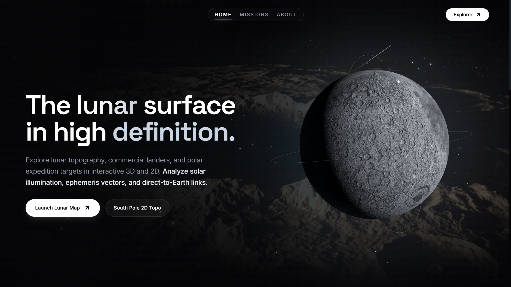
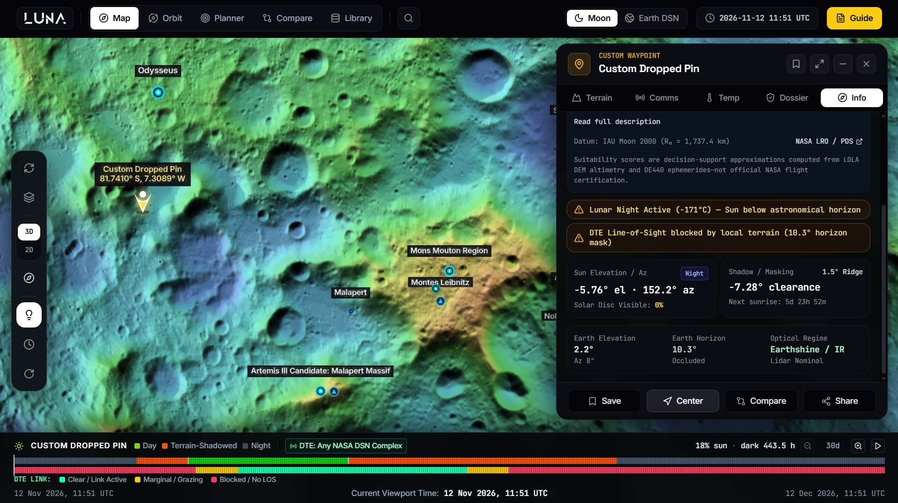
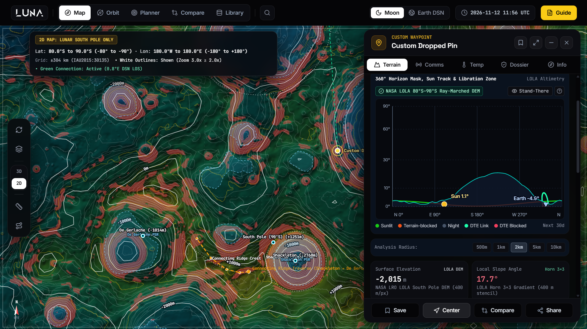
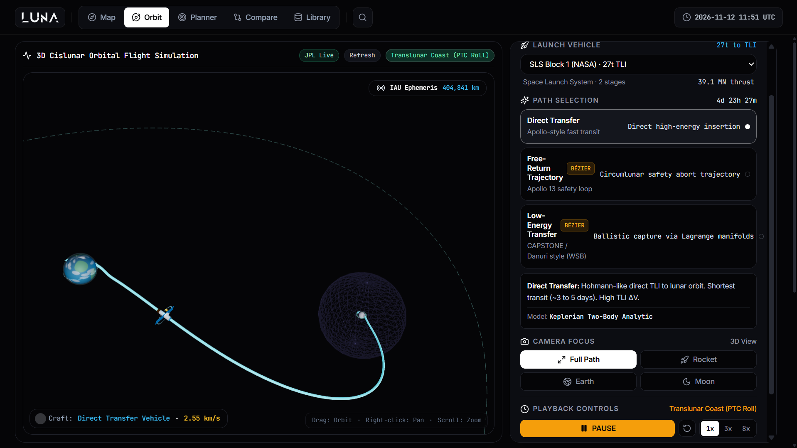
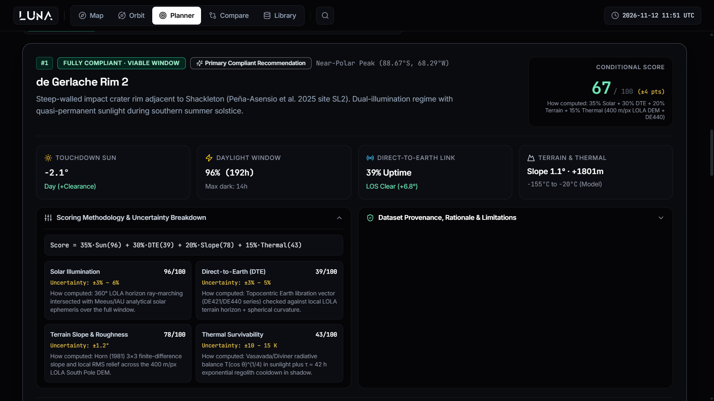
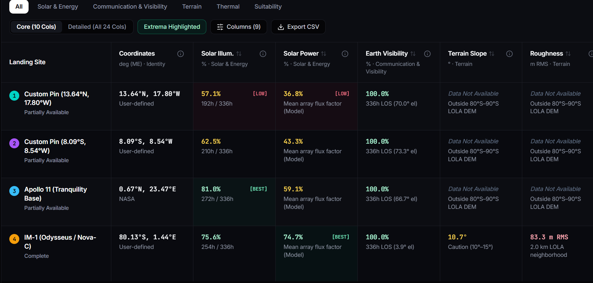

# Luna — Interactive 3D Moon & Artemis Mission Visualizer

> 🚀 Built for the **NASA Space Apps Challenge 2026** by team **awaylander.exe**

**LUNA** is a lunar mission browser for NASA **CLPS** and **Artemis** missions. Answering the challenge mentioned here : https://www.spaceappschallenge.org/2026/challenges/lunar-landing-site-navigator/, we, team **awaylander.exe** built **LUNA**.

## Screenshots

| | |
| :---: | :---: |
| <br>**Homepage** | <br>**3D Moon Explorer** |
| <br>**2D South Pole Topo Map** | <br>**Orbit Planner** |
| <br>**Landing Site Planner** | <br>**Site Comparison** |

---

## Features

| Workspace | What it does |
| :--- | :--- |
| **Explorer** (`#explorer`) | CesiumJS Moon/Earth globe plus a 2D South Pole polar-stereographic map (80°S–90°S, 400 m/px LOLA DEM) with contours, slope hazards, PSRs, and an A* least-cost EVA/rover route planner. Real-time 360° horizon mask classifies sites as Sunlit, Terrain-Shadowed, Night, or PSR. |
| **Trajectory** (`#trajectory`) | Cislunar planner for Direct TLI, Low-Energy WSB/BLT, Free-Return, and NRHO transfers with Δv budgets, transit timelines, and 3D/2D viewports. |
| **Landing Planner** (`#planner`) | Ranks 19 candidate sites over 3/7/14/28-day windows with a 4-factor suitability index: **Solar Illumination 35%**, **Direct-to-Earth 30%**, **Terrain & Slope 20%**, **Thermal 15%**. Includes polar ridge discovery and a LOLA literature validation panel. |
| **Comparison** (`#comparison`) | Side-by-side trade study of up to 8 sites/pins across mission epochs, with multi-page PDF export. |
| **Library** (`#library`) | CLPS and historic lander archive (IM-1/2, Blue Ghost etc.) with outcome filters, plus 25 Earth ground stations and their link specs. |

## Data & Methods

- **Terrain:** NASA LRO LOLA South Pole DEM (`LDEM_80S_400M`, 1520×1520, ~400 m/px)
- **Ephemerides:** `astronomy-engine` (VSOP87 / ELP2000-82) with IAU selenographic orientation and libration
- **Validation:** Mazarico et al. (2011), Gläser et al. (2018), Speyerer & Robinson (2013), Bussey et al. (2010)
- **Thermal / volatiles:** Vasavada et al. (2012), Colaprete et al. (2010), Sanin et al. (2017)
- **Comms:** Friis link budget, ITU-R P.618, NASA DSN 810-005

## Tech Stack

React 18 · Vite 6 · CesiumJS · Three.js · Leaflet (+ proj4) · D3.js · jsPDF · Tailwind CSS 3 · `astronomy-engine`

## Getting Started

Requires Node.js v20+ and npm v10+.

```bash
npm install          # install dependencies
npm run dev          # dev server at http://localhost:3000
npm run build        # production build to dist/
npm run preview      # preview production build
npx tsx --test tests/*.test.js   # run 24 test suites (191+ assertions)
npm run lint         # type checking
```

## Project Structure

```text
├── public/
│   ├── assets/                 # Planetary textures, UI assets
│   ├── data/
│   │   ├── lola_sp_80s_int16.bin  # LOLA South Pole DEM (80°S–90°S)
│   │   └── topo/               # Contours, PSRs, ridges, slope hazards
│   ├── images/missions/        # Lander & mission imagery
│   └── pictures/               # Lunar surface reference photos
├── scripts/                    # Offline DEM, horizon, and catalog audit scripts
├── src/
│   ├── cesium/                 # 3D Moon & Earth globe controllers
│   ├── components/
│   │   ├── analysis/           # Validation benchmark & site analysis
│   │   ├── celestial/          # Ephemeris clock & visibility controls
│   │   ├── communication/      # DTE link-budget calculator
│   │   ├── features/           # Site dossier (Info, Terrain, Thermal, Comms)
│   │   ├── globe/              # 3D PlanetViewport
│   │   ├── landing/            # Landing page & team overview
│   │   ├── layers/             # GIS layer controls
│   │   ├── map/                # 2D South Pole map & HUD
│   │   ├── measurements/       # Distance/area tools & A* EVA planner
│   │   ├── missions/           # Mission cards, comparison, schedule simulator
│   │   ├── navigation/         # Navbar, sidebar, search
│   │   ├── pins/               # Custom pin manager
│   │   ├── status/             # Space weather modal
│   │   └── trajectory/         # Orbital transfer viewport
│   ├── data/                   # Lunar catalog, CLPS missions, DSN stations, horizons.json
│   ├── guide/                  # Onboarding tour & shortcuts
│   ├── pages/                  # LandingPlanner, SiteComparison, MissionLibrary, Trajectory
│   ├── services/               # NASA WMTS/WMS layers, space weather, Worker wrappers
│   ├── utils/                  # Physics, ephemeris, thermal, horizon, DTE, scoring engines
│   └── workers/                # Web Workers for hillshade tiling & A* routing
└── tests/                      # Scientific verification & regression suites
```

## Team

**NASA Space Apps Challenge 2026 — Team `awaylander.exe`**

- Mishkatul Habib
- Nahid Iqbal
- Rafid Muammar
- Yeasin Anzam Rifat

All members are from **BUET CSE '24**.

---

*Suitability scores are decision-support approximations computed from LOLA DEM altimetry and DE440 ephemerides — not official NASA flight certification.*